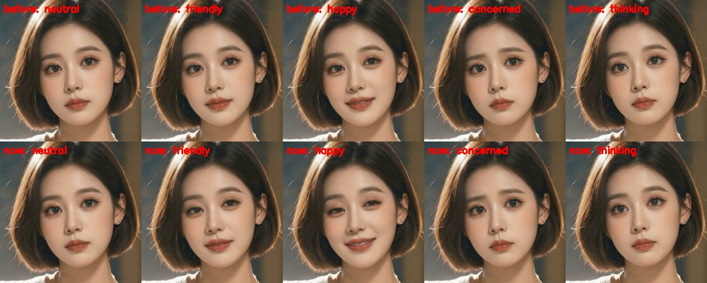

# Architecture

Living document — updated at the end of every phase. The research behind these decisions is in
[PHASE0_TECHNICAL_REPORT.md](PHASE0_TECHNICAL_REPORT.md).

## Project decisions (owner answers, 2026-09-29)

| Question | Answer | Consequence |
|---|---|---|
| Commercial use? | No — personal project | Non-commercial licenses (InsightFace, XTTS, F5, Fish) are acceptable; permissive ones still preferred |
| Languages | English | Kokoro stock voice, English STT setting, English embeddings |
| Avatar source | **One photo** | LivePortrait animates the photo offline into short loops (blink, gaze, head motion, emotions); MuseTalk lip-syncs them in real time |
| Voice | Stock **and** cloned | Kokoro by default; XTTS-v2 clone for voice-only use; a "light" clone (Kokoro + OpenVoice V2 converter) next to the avatar — one TTS resident at a time, chosen by profile |
| Where the browser runs | Owner's own PC (remote) | HTTPS required for the microphone → HTTPS tunnel or LAN TLS; WebSocket transport (tunnel-friendly) |
| RAM upgrade | No | Keep processes and caches small; load weights straight to GPU; measure RAM every phase |

## Processes

```
Browser (owner's PC) ──HTTPS/WSS──► P1 backend (FastAPI, .venv torch 2.9.1+cu130)
   (tunnel or LAN TLS, token)           │  VAD (CPU) · STT (GPU) · RAG (CPU) · TTS (GPU) · state machine
                                        ├──HTTP SSE──► P2 llama-server.exe (Qwen3-4B Q4_K_M)
                                        ├──WS binary+JSON─► P3 avatar worker (avatar/musetalk/.venv)   [avatar profiles]
                                        └──WS binary+JSON─► P4 XTTS-v2 worker (voice/xtts/.venv)       [clone profile]
```

All helper processes are supervised by the backend (restart on crash) and live in a Windows Job
Object, so they die with it.

## Phase status

| Phase | Status | Evidence |
|---|---|---|
| 0 Safety + research | done | see "Phase 0 results" |
| 1 Text conversation | done | see "Phase 1 results" |
| 2 Voice pipeline | done | see "Phase 2 results" |
| 3 Interruption | done | see "Phase 3 results" |
| 4 Realistic avatar | done | see "Phase 4 results" |
| 5 RAG | done | see "Phase 5 results" |
| 6 Hardening, remote access, cloned voice | done | see "Phase 6 results" |

## Phase 0 results (measured on POOH-PC, 2026-09-29)

| Metric | Value |
|---|---|
| torch / CUDA | 2.9.1+cu130 / 13.0, RTX 3060 detected, `check_env.py` passes |
| VRAM used by desktop before start | ~2.0 GiB |
| CUDA context cost (lazy loading) | 111 MiB |
| fp16 / bf16 matmul | 25.6 / 25.9 TFLOPS |
| Host→GPU copy | 12.3 GB/s pinned, 3.5 GB/s pageable |
| Safe VRAM allocation ceiling (0.5 GiB reserve) | 10.25 GiB |
| System RAM available | 1.3–1.9 GiB of 15.7 GiB |

## Phase 1 results (text conversation)

Measured with `scripts/bench_text.py` (14 turns + cancel) and Playwright `tests/e2e/phase1_text.spec.js` (3/3 pass).
Raw data: [benchmarks/phase1_text.json](benchmarks/phase1_text.json).

| Metric | Value |
|---|---|
| LLM | Qwen3-4B-Instruct-2507 Q4_K_M on llama-server b11242 (CUDA 12.4 build), ctx 4096, q8_0 KV |
| llama-server start → ready | 4.2 s (warm disk cache) |
| VRAM used by LLM | ~2.9 GiB |
| llama-server resident RAM | 725 MB with `-lm none` (2,492 MB with default mmap) |
| First token (warm, prefix cached) | 35–50 ms |
| First visible text (after behaviour tag) | **p50 176 ms**, max 278 ms |
| Decode speed | 87 tokens/s |
| Behaviour-tag compliance | 100 % of normal turns |
| Cancel → acknowledged | 5.8 ms; llama-server log confirms `stop: cancel task` |
| History trim (every ~4 turns) | 262 tokens re-processed (~150 ms) thanks to `--cache-reuse 256` |
| First turn after idle | ~265 ms first token (GPU clock ramp-up from P8) |

Design notes:
- The compact tag `[emotion|gesture|intensity]` replaced a JSON header: the JSON version delayed the
  first spoken word by ~230 ms, the compact one by ~130 ms.
- Every outbound packet carries `turn_id`; the single-writer outbox drops data of non-current turns.
- One active session: a new connection takes over (the old one gets close code 4001).

## Phase 2 results (voice pipeline)

Measured with `scripts/bench_voice.py latency --rounds 2` (16 spoken questions streamed in real time over the
real protocol) and Playwright `tests/e2e/phase2_voice.spec.js` (Chromium fake microphone).
Raw data: [phase2_voice.json](benchmarks/phase2_voice.json), [phase2_models.json](benchmarks/phase2_models.json).

| Metric (ms after the user's last voiced audio) | p50 | p90 | max |
|---|---|---|---|
| VAD endpoint (550 ms silence rule) | 572 | 593 | 608 |
| STT done (speculative, started after 120 ms silence) | 619 | 683 | 683 |
| LLM first token | 681 | 735 | 846 |
| LLM first spoken text | 793 | 868 | 980 |
| First clause ready | 924 | 1021 | 1082 |
| TTS first audio ready | 1099 | 1241 | 1400 |
| **End of speech → first audio (client)** | **1109** | **1254** | **1422** |

- Browser (Playwright) run: 1,052 ms end of speech → first audio played.
- Transcripts: 16/16 exact. Speculative STT reused in 16/16 turns.
- Models: Whisper large-v3-turbo fp16 (1.75 GiB VRAM, 190 ms warm), Kokoro-82M (0.55 GiB, ~120 ms/clause, RTF 0.05).
- VRAM with LLM + STT + TTS resident: 7.2 GiB of 12 GiB (≈ 2 GiB of it is the Windows desktop).
- Backend process RAM: ~2.5 GB.

Findings:
- After ~2 s of GPU idle (while the user talks) Whisper takes ~390 ms instead of ~185 ms, even though the SM
  clock reads 1.9 GHz; keeping CPU or GPU busy barely helps (`scripts/bench_gpu_idle.py`). Hiding STT behind
  the endpoint wait (speculative STT on a 120 ms pause) removes it from the critical path.
- Recommended manual setting: NVIDIA Control Panel → Manage 3D settings → Program settings → `python.exe`
  (repo `.venv`) and `llama-server.exe` → *Power management mode: Prefer maximum performance*.

## Phase 3 results (interruption / barge-in)

Measured with `scripts/bench_voice.py bargein --rounds 4` (real-time protocol client) and Playwright
`tests/e2e/phase3_bargein.spec.js` (fake mic says "Wait, stop please. What is two plus two?" while the
assistant tells a story). Raw data: [phase3_bargein.json](benchmarks/phase3_bargein.json),
[phase3_bargein_browser.json](benchmarks/phase3_bargein_browser.json).

| Metric | Value |
|---|---|
| Spec target: stop ≤ 200–300 ms after *confident* speech detection | **met** — cancel fan-out ~0.1 ms + browser flush 1–8 ms after detection (confident detection itself needs 260 ms of speech, the echo guard, so ~350 ms after the first sound) |
| Barge-ins detected | 4/4 (bench) + 1/1 (browser) |
| Detection after the user's speech onset | p50 348 ms, max 362 ms (bench); ~414 ms (browser, approx.) |
| — of which the confidence rule | 260 ms of speech with p ≥ 0.75 while the assistant is active |
| Server cancel fan-out (LLM stream, TTS, queues, state) | ~0.1 ms |
| Browser: interrupt message → audio flushed | 7.7 ms |
| Stale audio packets after the interrupt | 0 (server), 0 blocked needed (client) |
| History records what was actually heard | yes, e.g. "Well, there once was a tiny fox named Flick [interrupted by the user]" |
| Follow-up question answered after barge-in | 4/4 ("Two plus two is four.") |
| Manual Stop button (voice) | passes |

How it works: the VAD keeps running while the assistant speaks, with a stricter threshold; a confirmed
barge-in fires `BARGE_IN` → the turn's asyncio tasks are cancelled (closing the llama-server stream stops
generation), the outbox drops the turn's queued packets, the browser flushes its AudioWorklet buffer and
rejects the turn id, the avatar worker gets `cancel`, and the words heard so far (from Kokoro word
timestamps and the browser's playback position) go into the history. The barge-in audio itself becomes
the start of the next user utterance.

Echo: browser echo cancellation / noise suppression are enabled; the stricter threshold applies while
the assistant is active; and a transcript that mostly repeats the assistant's last words is dropped as echo
(`echo_ignored`). Acoustic echo cannot be tested with a fake microphone — use headphones for development
and try speakers once (see "Manual checks").

## 30-minute stability test (Phases 2 + 3)

Playwright `tests/e2e/soak.spec.js` with a looping fake microphone (a question every ~19 s; long answers
get barged into). Raw data: [phase3_soak_30min.json](benchmarks/phase3_soak_30min.json).

| Metric | Value |
|---|---|
| Duration / turns | 30 min / 95 turns (94 completed, 1 barge-in) |
| Server errors / browser errors | 0 / 0 |
| llama-server restarts | 0 |
| End of speech → first audio | p50 1,210 ms · p90 1,470 ms · max 1,612 ms |
| VRAM used (whole GPU) | 7,459 → 7,791 MiB (max 7,796) — no leak |
| Backend resident RAM | 2,602 → 714 MiB (Windows trims the working set under memory pressure) |

(Package installs and model downloads for Phase 4 were running in parallel during this test.)

## Phase 4 results (realistic avatar from one photo)


*Left to right: the input photo, then the neutral / friendly / happy / concerned / thinking loops rendered
by the face rig.* While speaking, MuseTalk replaces the mouth region:


### Renderer comparison (measured on this PC)

The Phase 0 report compared ten engines on paper ([PHASE0_TECHNICAL_REPORT.md §4](PHASE0_TECHNICAL_REPORT.md));
Ditto, AVTR-1, FlashHead and LAM asset generation need Linux/WSL2, TensorRT or flash-attn builds
(ruled out by the "no source compilation, keep the Windows CUDA stack" rules), and the diffusion
models (EchoMimic, Hallo, LiveAvatar) are offline-only. Three approaches that run natively were measured:

| | **MuseTalk 1.5 + LivePortrait face rig** (chosen) | **LivePortrait, driven live** (e.g. JoyVASA-style audio → motion → LivePortrait) | **LiteAvatar** (HumanAIGC, MIT) |
|---|---|---|---|
| Avatar from one photo | ✓ (loops rendered offline from the photo) | ✓ | ✗ — gallery avatars made from recorded video; no public creator |
| Speed on this PC | **24.3 fps** (GPU, batch 8), 20–23 fps live with the full stack | **4.7 fps** (213 ms/frame, PyTorch; real time needs TensorRT → WSL2/Linux) | **20.4 fps** CPU with 4 parallel workers (7.9 fps one thread; native rate 30 fps) |
| Resource use | 3.5 GiB VRAM reserved (2.6 GiB allocated) | not measured alone (avatar build with MuseTalk prep peaked at 6.8 GiB) | 0 VRAM, **3.1 GB RAM**, all CPU cores busy at 20 fps |
| First frame | 4–6 frames in 370–650 ms (A/V gate) | — | 443 ms for a 2 s clause (audio features 0.11× real time) |
| Blink / gaze / head / expression | ✓ via the rig (5 expression loops) | ✓ (full control) | from the recorded video only |
| Output | 512×512 face | 512×512 face | 890×1920 upper body |
| Language of the lip model | multilingual (Whisper features) | depends on the motion model | Chinese ASR features (Paraformer zh-cn) |
| Coexists with LLM + STT + TTS on 12 GB | ✓ (measured, 30-minute soak) | ✗ not real time | ✓ on GPU, but competes for CPU and RAM (both scarce here) |

MuseTalk was chosen because it is the only one that is real time on this PC **and** works from one
photo; LivePortrait is kept for what it does well offline (expressions, blinks, gaze, head motion).
LiteAvatar is the fallback for a GPU-less machine if a video-recorded avatar is acceptable.
Raw data: [phase4_musetalk_engine.json](benchmarks/phase4_musetalk_engine.json),
[phase6_liteavatar.json](benchmarks/phase6_liteavatar.json); LivePortrait speed from `logs/build_avatar.log`.
Reproduce LiteAvatar: `powershell -File avatar\liteavatar\setup.ps1`, then
`avatar\liteavatar\.venv\Scripts\python avatar\liteavatar\bench_liteavatar.py`.

### How it works

1. **Offline, once per photo** (`avatar/musetalk/build_avatar.py`, ~6 min): a procedural *face rig* on
   LivePortrait renders five 7-second loops at 20 fps. All loops share one seeded motion curve
   (head drift ±2°, ~17 blinks/min, micro-saccades with eye contact) and differ only in expression
   (smile, eyebrows, gaze), so the worker can switch loops at the same frame index. MuseTalk then
   pre-computes face boxes (DWPose via ONNX, S3FD), VAE latents and blend masks for each loop.
2. **Live** (`avatar/musetalk/worker.py`, own venv/process): idle frames stream at 20 fps; the loop
   follows the conversation state (listening → friendly, thinking → gaze away) and the LLM's emotion
   tag (empathetic/concerned → concerned, happy → happy, ...). Each TTS clause is lip-synced by MuseTalk
   and every frame carries a pts on the turn's audio timeline; the browser draws frames by the
   *audible* audio position (`AudioContext.getOutputTimestamp`), so sync survives network jitter.
3. **A/V gate**: a turn's first audio is released only when its first 6 lip-synced frames exist
   (batches ramp 2 → 4 → 8), so video never lags at the start of a reply. (Phase 6: 4 frames for the
   stock voice, 6 for the cloned voice — see "Latency work".)

### Measurements (RTX 3060, whole stack resident)

| Metric | Value |
|---|---|
| Photo → avatar build | LivePortrait 213 ms/frame (5×140 frames, 2.5 min) + MuseTalk prep ~35 s/loop |
| MuseTalk throughput, alone | 13.2 fps baseline → **24.3 fps** after optimisation (1.21× real time at 20 fps) |
| — optimisation 1 | decode only latent rows ≥ 12 (the blend mask covers the lower half): VAE 44.7 → 27.7 ms/frame, mean abs diff 1.9/255 |
| — optimisation 2 | two-stage pipeline: GPU batch k+1 overlaps CPU composite/JPEG of batch k |
| MuseTalk under continuous LLM load | 9.3 fps (real turns overlap the LLM only briefly) |
| Live render speed (26 clauses) | 18–24 fps, first 6 frames in 363–745 ms |
| A/V sync in the browser (3 runs) | median frame offset 27–30 ms, p90 45–126 ms, 0–11 % frames late |
| End of speech → first audio, **avatar on** (16 turns) | **p50 1,750 · p90 1,914 ms** (gate 6) |
| — with `gate_frames: 2` | p50 1,513 · p90 1,690 ms; 12–14 % frames late, up to ~250 ms at reply start |
| VRAM peak (LLM + Whisper + Kokoro + MuseTalk + desktop) | 9.5 GiB of 12 GiB |
| Emotion → loop | verified: sad → concerned, good news → happy, "let me think" → thinking |

Raw data: [phase4_musetalk_engine.json](benchmarks/phase4_musetalk_engine.json),
[phase4_voice_with_avatar.json](benchmarks/phase4_voice_with_avatar.json),
[phase4_voice_with_avatar_gate2.json](benchmarks/phase4_voice_with_avatar_gate2.json),
[phase4_avatar_browser.json](benchmarks/phase4_avatar_browser.json).

### Lessons / fixes found while measuring

- A force-stopped backend used to leave the avatar worker running; the next backend then connected to
  the stale worker (old code, VRAM held). All helper processes now live in a Windows Job Object with
  kill-on-close, and stale listeners on our ports are cleared before spawning (`app/core/procjob.py`).
- Running a second MuseTalk process next to the full stack exceeded 12 GB: Windows silently spilled
  VRAM to system RAM and throughput fell to 1–6 fps. Keep one avatar engine, and set NVIDIA
  *Sysmem Fallback Policy → Prefer No Sysmem Fallback* so this becomes a clear error instead.
- The GPU is slower for the first batches after it sat idle; the worker runs a 150 ms warm-up burst
  when the conversation enters THINKING (after STT, before the first clause).

### Limitations

- Hand / upper-body gestures are not animated: the avatar is a head-and-shoulders portrait, and none of
  the real-time engines that run on this PC animate a body (see the comparison above). Head gestures
  (nod, small nod, head tilt, shake) are rendered since Phase 6 — see "Head gestures".
- MuseTalk renders the mouth at 256×256 inside a 512×512 frame; larger output needs a stronger GPU.
- The development photo is AI-generated (from OpenAvatarChat's resources). Build your own avatar with
  `build_avatar.py --photo <your photo> --id <name>` and set `avatar.avatar_id`.

## Phase 5 results (document-grounded answers)

Pipeline: `scripts/ingest.py` parses PDF (pypdf), DOCX (python-docx), Markdown/TXT and HTML → cleans
(PDF hyphenation, whitespace) → heading-aware chunks (~220 words, 30-word overlap, source/section/page
metadata) → bge-small-en-v1.5 embeddings on CPU → LanceDB. Per turn: embed the question → top-k (4)
cosine search → passages with similarity ≥ 0.62 go into the latest user message as numbered KNOWLEDGE
(keeps the cached prompt prefix intact); if the best match is only 0.50–0.62 the model is told the
documents do not contain the answer; below 0.50 the question is treated as general conversation.
Citations (source, section, page, score) are sent to the UI and shown under the answer — not spoken.

Test set: a deliberately **fictional** knowledge base (bakery, company policy, lamp manual, hiking trail)
in all four formats, so correct answers can only come from retrieval
(`scripts/make_knowledge_fixtures.py`; the PDF is printed by Playwright's Chromium).

| Metric | Value |
|---|---|
| Questions answered correctly with the right source cited | 6/6 |
| Unanswerable question ("Wi-Fi password") declined without inventing | yes |
| General question ("capital of France") answered, no citation | yes |
| Total | **8/8** (`scripts/bench_rag.py`) |
| Retrieval latency (CPU) | embed p50 20 ms + search ~6 ms (max 67 ms incl. first call) |
| Spoken question in the browser (Playwright, `mic_rag.wav`) | exact transcript, correct answer, citation shown, first audio 1,290 ms |
| Index build (10 chunks, 4 files) | 18.8 s (mostly loading the embedding model) |

Raw data: [phase5_rag.json](benchmarks/phase5_rag.json), [phase5_rag_browser.json](benchmarks/phase5_rag_browser.json).

Add your own documents: put files in `data/knowledge/` and run `.venv\Scripts\python scripts\ingest.py`
(the backend loads the index at start-up). Web pages (Phase 6): `scripts\ingest.py --url <page>`
(repeatable) saves the page into `data/knowledge/web/` and indexes it with the rest; the citation shows
host and path. Checked with a Wikipedia article (72 chunks, 26 s): "How many hearts does an octopus
have?" → its "Circulatory system" section (score 0.755); an unrelated question → no passage.

## Phase 6 results (hardening, remote access, cloned voice)

### Profiles

One profile = one set of resident models (`config/profiles/*.yaml`, selected with `run.ps1 -Profile`).
VRAM = what the stack itself uses right after start-up (GPU memory used after loading minus before
starting); the Windows desktop and other apps come on top (1.4–3.5 GiB measured on this PC), and
activations add ~0.4 GiB during use.

| Profile | STT | Voice | Avatar | VRAM (stack) | End of speech → first audio (p50 / p90) |
|---|---|---|---|---|---|
| `default` | Whisper large-v3-turbo | Kokoro (stock) | – | 5.2 GiB | **922 / 1,048 ms** (Phase 2: 1,109 / 1,254) |
| `lite` | whisper-small.en, LLM context 3,072 | Kokoro | – | 4.1 GiB | **873 / 1,007 ms** |
| `clone` | large-v3-turbo | XTTS-v2 clone | – | 6.7 GiB | **1,271 / 1,425 ms** (before the latency work: 1,526 / 1,768) |
| `avatar` | large-v3-turbo | Kokoro | MuseTalk | 8.8 GiB | **1,160 / 1,359 ms** (Phase 4: 1,750 / 1,914) |
| `avatar_clone` | large-v3-turbo | light clone | MuseTalk | 9.0 GiB | **1,306 / 1,369 ms** (first version: 2,854 with XTTS) |

All latencies: `scripts/bench_voice.py latency --rounds 2` (16 spoken questions streamed in real time over
the real protocol, 16/16 exact transcripts in every profile), after the latency work below. Raw data:
[phase6_profile_clone.json](benchmarks/phase6_profile_clone.json), [phase6_profile_lite.json](benchmarks/phase6_profile_lite.json)
and the files linked below.

**Model scheduling — measured** (`scripts/bench_scheduling.py`, [phase6_scheduling.json](benchmarks/phase6_scheduling.json)).
The Phase 0 plan listed A (all resident) vs B (controlled scheduling). Cost per turn for the backend's GPU models:

| Model | A resident (inference) | B2 park in CPU RAM between turns | B3 load from disk every turn |
|---|---|---|---|
| Whisper large-v3-turbo | 186 ms | +481 ms per turn (swap-in 470 ms); frees 1.5 GiB VRAM, needs +1.2 GiB RAM | +2,764 ms |
| Kokoro-82M | 121 ms | +120 ms; frees 0.3 GiB VRAM, +0.3 GiB RAM | +1,786 ms |

So the stack keeps its models **resident (A)** and serialises its own GPU work with one lock (B1:
STT, TTS and the keep-warm pass never overlap); swapping would add ~0.6 s to every turn to save
1.8 GiB, and needs system RAM this PC does not have. What does not fit is handled by profiles and
the VRAM guard instead of swapping.

A VRAM guard checks free VRAM before each model loads (needs from measurements, plus a 0.8 GiB
reserve). If a model would not fit it is skipped instead of letting Windows spill VRAM into system RAM
(which silently makes everything ~10× slower): clone voice → stock voice, or voice/avatar disabled. The
reason appears in `/health` → `warnings` and in the UI.

### Latency work

Where the time went (default profile, before): the VAD waits 550 ms of silence before ending a turn;
the speculative STT started at 120 ms of silence took 400–500 ms, so the transcript was ready only
around the endpoint; the LLM then needed ~350 ms for the behaviour tag and the first clause; TTS ~150 ms.

| Change | Effect (measured) |
|---|---|
| **Answer prefetch** (`session/prefetch.py`): RAG + LLM start at the VAD pause, as soon as the speculative transcript exists; the deltas are buffered and used at the endpoint only if the user stayed silent and the text is identical, otherwise cancelled (llama-server stops). A new VAD `resume` event cancels it as soon as the user keeps talking. | used in 16/16 benchmark turns; on its own it gained little, because the STT was the bottleneck |
| **GPU keep-warm while the user talks**: an encoder pass on silence every 400 ms, only while speech is active (never in the silence before the speculative STT, never while the assistant or another GPU job runs). The GPU drops its clocks within ~2 s of idle (P3, 570 MHz); small matmul/memcopy keep-alives, a CPU spin or a higher process priority did not prevent it, the real encoder workload does. | Whisper encoder after 2 s idle 150–300 ms → **133 ms**; speculative STT 400–500 ms → **170–190 ms**; transcript ready at p50 326 ms (was 545) |
| **Lean Whisper decoding**: greedy loop with the same prompt and token suppression instead of `generate()` | identical transcripts on all 15 fixtures (both models); ~18 ms less per utterance |
| **Avatar: no MuseTalk warm-up burst** at THINKING (it now competed with the prefetched LLM) | first clause p50 796 → 730 ms, render time unchanged |
| **Avatar: A/V gate 4 frames** (was 6) | ~70 ms; browser test 0 late frames in 3 runs |
| **Avatar: first batch = exactly the gate** (4 frames in one batch instead of a 2 + 4 ramp, which rendered 6 frames before the gate could open) | gate opens after 243 ms instead of 337 ms (engine measured alone); live, the avatar's share of the first-audio time 421 → **314 ms**; 0 late frames in 3 + 4 browser runs (both avatar profiles), so `avatar_clone` now also uses gate 4 (it needed 6 before) |

Result, end of speech → first audio p50 (p90):
- voice only: 1,109 → **922 ms** (1,048) — the < 1 s stretch goal; 16/16 turns under 1.2 s, 12/16 under 1 s
- avatar: 1,750 → **1,160 ms** (1,359) — **meets the ≤ 1.2 s target at the median**; 9/16 turns under 1.2 s
- avatar + cloned voice: 2,854 → **1,306 ms** (1,369) — 5/16 under 1.2 s; the tone-colour converter adds
  ~70–150 ms to the voice step

Measured on the same PC on different days with different desktop load: the voice step of the last avatar
run was ~140 ms faster than in the previous one (less GPU load from other apps), so not all of the
1,357 → 1,160 ms gain comes from the code; the avatar's own share (421 → 314 ms) does. What is left is
mostly fixed cost: the 550 ms endpoint rule (a shorter one would cut people off in natural pauses),
TTS, and rendering the first lip-synced frames.

Checked again after these changes: barge-in 4/4 (detection p50 354 ms, 0 stale packets, follow-ups
answered), browser barge-in (342 ms, flush 1.3 ms), RAG answer with citations through the prefetch
path, text/voice/avatar/recovery tests. Raw data: [phase6_voice_prefetch.json](benchmarks/phase6_voice_prefetch.json),
[phase6_avatar_prefetch.json](benchmarks/phase6_avatar_prefetch.json) (gate 6 + burst),
[phase6_avatar_gate6_noburst.json](benchmarks/phase6_avatar_gate6_noburst.json),
[phase6_avatar_gate4.json](benchmarks/phase6_avatar_gate4.json),
[phase6_avatar_gate_batch.json](benchmarks/phase6_avatar_gate_batch.json),
[phase6_avatar_clone_gate4.json](benchmarks/phase6_avatar_clone_gate4.json),
[phase6_bargein_prefetch.json](benchmarks/phase6_bargein_prefetch.json).

### Remote access (browser on another PC)

Browsers only allow the microphone on HTTPS (or localhost), so there are two ways in, both protected by
a random access token (`AVATAR_ACCESS_TOKEN`; the WebSocket is closed with code 4003 and the UI shows
"access denied (token)" for a wrong or missing token):

- **Internet:** `scripts\tunnel.ps1 -Profile avatar` starts the backend and a free Cloudflare quick
  tunnel (no account; `cloudflared` is downloaded to `tools/` on first use) and prints
  `https://<random>.trycloudflare.com/?token=...`. Traffic passes through Cloudflare; the link changes
  each time. Measured: the Phase 2 browser test through the tunnel gave 1,171 ms end of speech → first
  audio (1,052 ms locally).
- **LAN:** `scripts\run.ps1 -Profile avatar -Https` creates a self-signed certificate
  (`scripts/make_cert.py`, written to the git-ignored `certs/`), listens on all interfaces and prints
  `https://<LAN IP>:8000/?token=...`. Accept the certificate warning once.

The page keeps the token for the browser tab (sessionStorage), so reconnects keep working.

### Cloned voice: two engines

| | XTTS-v2 (profile `clone`) | Light clone (profile `avatar_clone`, engine `clone_light`) |
|---|---|---|
| How | zero-shot cloning TTS, streamed in ~1 s chunks, own process/venv | Kokoro speech → OpenVoice V2 tone-colour converter (timbre only), in the backend |
| Speaker similarity to the reference¹ | **0.749** | **0.654** (0.55 before conversion) |
| Unrelated voice, for scale¹ | 0.429 | 0.429 |
| Intelligibility (Whisper transcript of a 29-word sample) | 0 word errors | 0 word errors |
| Cost | real-time factor 0.54–0.57, first chunk ~465 ms | Kokoro 83 ms + converter 66 ms per clause (real-time factor 0.05) |
| VRAM | ~2.2–2.6 GiB | ~0.2 GiB |
| License | CPML (non-commercial) | Kokoro Apache-2.0, OpenVoice MIT |

¹ Cosine similarity of XTTS-v2 speaker-encoder embeddings (`voice/xtts/bench_clone.py --score`). The
development reference `data/voices/dev_emma.wav` is itself a Kokoro voice (bf_emma), because no real
recording was available; bf_emma was excluded when choosing the base voice. Results with a real
recording will differ: record 10–15 s of clean speech (with the speaker's consent).

The light clone only changes timbre; accent and speaking style come from the Kokoro base voice, and the
best base voice cannot be predicted from the converter's own distance (measured). So
`scripts/pick_clone_voice.py --ref <wav>` tries all 28 English Kokoro voices (synthesise → convert →
score) and prints the one to put in `tts.voice` (for the dev reference: bf_isabella 0.655, bf_alice
0.644, bm_lewis 0.614, ..., af_heart 0.487). Kokoro now uses British G2P for `b*` voices.

**Why XTTS is not used next to the avatar** (measured, [phase6_gpu_contention.json](benchmarks/phase6_gpu_contention.json)):
XTTS's autoregressive GPT and MuseTalk time-slice the GPU. With both running, MuseTalk drops from 24.3
to 10.4 fps and XTTS's real-time factor rises from 0.57 to 0.75; per second of speech they need ~1.4 s
of GPU time. XTTS cannot be made cheaper here: non-streaming synthesis costs the same (the vocoder is
not the bottleneck) and fp16 autocast is slower. In the live stack the first reply audio came after
2.9 s and the lips fell behind the voice.

Fixes that came out of this work (they also protect the XTTS path):
- The avatar worker's render loop died on a segment shorter than one video frame (MuseTalk's feature
  code concatenates an empty list); the next turns then waited 1.5 s per chunk and showed no lip sync.
  Segments are now isolated (an error is logged and the segment released), empty ones are skipped, and
  contiguous segments of a turn get the previous 200 ms of audio as left context, so the lips do not
  close at every ~1 s chunk boundary.
- Streaming chunks that arrive while the avatar is rendering are merged into one segment.

### Avatar + cloned voice (profile `avatar_clone`)

| Metric | Value |
|---|---|
| End of speech → first audio (16 turns, `bench_voice.py`) | p50 1,306 · p90 1,369 · max 1,439 ms with the latency work above (1,786 before it; 2,854 with XTTS) |
| Waits for avatar frames > 1.5 s | 0 (was 32 in 8 turns with XTTS) |
| Live render speed | 20–23 fps |
| Browser A/V sync (Playwright `phase4_avatar`) | gate 6, 5 runs: 6 of 807 frames late; gate 4 with the gate-sized first batch, 4 runs: 0 of 650 late, offset p90 37–50 ms |
| VRAM | stack 9.0 GiB (avatar with stock voice: 8.8 GiB); XTTS instead of the converter would need ~2.2 GiB more |

Raw data: [phase6_avatar_clone.json](benchmarks/phase6_avatar_clone.json),
[phase6_clone_light.json](benchmarks/phase6_clone_light.json),
[phase6_clone_voice.json](benchmarks/phase6_clone_voice.json) (XTTS),
[phase6_voice_clone.json](benchmarks/phase6_voice_clone.json) (XTTS profile latency).

### Head gestures

The BehaviorManager's `gesture` (from the LLM's tag, or a state default such as a small nod when the
avatar starts listening) is now rendered as real 3D head motion, not a 2D warp:

- **Offline** (`build_avatar.py`): for each natural expression/gesture pair the LivePortrait rig renders
  a *gesture variant* of the expression loop that differs only inside short windows (nod: head down
  and up twice, 6° then 3.6°; small nod: once, 4°; head tilt: ease in, hold, ease out, 5°; shake:
  side to side, ≤ 5.5°; `avatar/musetalk/motion.py`). Every gesture curve starts and ends at the
  loop's own pose, so window frames join the loop seamlessly. Only the window frames are rendered
  and MuseTalk-prepared and stored as a delta. 14 variants for the dev avatar: 1,272 frames,
  ~10 min once (`--gestures-only` adds them to an existing avatar and skips variants that exist),
  6–7.5 MB each on disk, **+98 MiB RAM** in the worker (unchanged frames and latents are shared).
- **Live** (`gestures.py`, worker): a requested gesture is played in the next window of the current
  loop (within ~0.6–2 s; loops play ping-pong, so windows exist mirrored too), per frame for both the
  idle stream and the lip-synced frames, so MuseTalk paints the mouth onto the moving head. A gesture
  that is playing is never cut short; a reply's gesture replaces a listening nod that has not started
  yet, or follows one that is playing; state gestures are limited to one every 5 s; a "nod" below
  intensity 0.45 is played as a small nod; "smile" is an expression, not a head motion.

| Checked | Result |
|---|---|
| Rendered gestures (contact sheet, `gesture_strip.py`) | nod / small nod / tilt / shake visible, subtle, no jump at window edges |
| LLM → avatar (worker log) | "Do you agree…" (friendly, small_nod 0.5) → played; "I failed my exam…" (empathetic, small_nod 0.7) → played; "Yes or no: is water wet?" (thinking, head_tilt 0.4) → played. Which gesture the LLM picks varies; small nods and "none" are its most common choices |
| Found and fixed | first version dropped a reply's gesture whenever the listening nod was still scheduled (the 30-minute run B shows only small nods for that reason); now covered by `test_earliest_start_rules` |
| Which gesture fits the reply (`scripts/bench_gestures.py`: 14 prompts × 2, e.g. "Is it safe to look at the sun?" → shake, "…, right?" → nod, "Guess what…" → tilt) | LLM tag alone: **64 %** fitting, it never chose nod or shake (it writes the tag before it "knows" whether the answer is yes or no; telling it what each gesture means made it nod at "No, …" answers: 50 %). Now the reply's **first words refine the tag** before that clause's audio reaches the avatar ("Yes / Absolutely / Exactly …" → nod, "No / Not quite / I'm afraid not …" → shake, "I'm sorry …" → small nod, an opening question → tilt; `refine_gesture` in `behavior/manager.py`): **89 %** fitting, all six gestures used, no added latency, tag compliance 100 % ([phase6_gesture_choice.json](benchmarks/phase6_gesture_choice.json)). Live: "No, it's not safe…" → shake, "Yes, absolutely…" → nod |
| Browser A/V with gestures (Playwright `phase4_avatar`, which now also asserts gestures were played) | 0–6 late refreshes of ~160, A/V offset p90 48–75 ms |
| Unit tests | curves start/end at rest, ≤ 6°; windows inside the loop, non-overlapping; mirrored windows; scheduling; intensity rules (`test_avatar_gestures.py`) |

Soaks with gestures (busy PC, profile `avatar_clone`): the 30-minute run B in "30-minute soak" below
(0.46 % late frames, first version of the scheduling), and a 10-minute run on the final code: 31/31
turns, 0 errors and restarts, **63 gestures — 34 requested by the replies, 29 listening nods**,
1.7 % late frames, A/V offset p90 42 ms, first audio p50 1,440 ms, our GPU memory +54 MiB in the
second half ([phase6_soak_gestures_10min.json](benchmarks/phase6_soak_gestures_10min.json)).
After the first-words refinement and the gate-sized first batch, profile `avatar`, 10 minutes: 32/32
turns, 0 errors and restarts, 0.4 % late frames, no frame arrived > 100 ms late, A/V offset p90 39 ms,
first audio p50 1,280 ms (the soak's questions are longer than the benchmark's), GPU memory +0 MiB
([phase6_soak_avatar_final_10min.json](benchmarks/phase6_soak_avatar_final_10min.json)).

Hand / upper-body gestures remain out of scope: the portrait is head-and-shoulders and no real-time
engine that runs on this PC animates a body (see the renderer comparison in Phase 4).

### Speech recognition, speech output and gaps (owner's test, 2026-10-03)

The owner reported that their speech was not recognised correctly and that the avatar's speech had
"lots of gaps". The log of that session: three spoken turns, each interrupted by the next one; one had
5.3 s of speech but a 2-word transcript; and before every sentence after the first the backend waited
up to 1.5 s for avatar frames (`avatar first frame ... not ready after 1.5s`). Checked one by one:

**Gaps in the avatar's speech** — three causes, all fixed; measured in the browser with a 5-sentence
reply (`tests/e2e/phase6_speech_gaps.spec.js`: silences inside the received audio + time the player
ran dry):

| Cause | Before | After |
|---|---|---|
| Every sentence after the first waited for its first lip-sync frame (up to 1.5 s) | player ran dry up to 1.5 s per sentence | only the first sentence waits (A/V start); later ones are sent at once: **player never ran dry** |
| Kokoro wraps every clause in ~0.3 s silence before and ~0.5 s after | ~0.8 s between sentences; first word 0.3 s late | padding replaced by a natural pause (sentence 260 ms, comma 130 ms): **longest pause 380–400 ms, first word after 20 ms** |
| The sentence splitter broke after "Dr.", "Mr.", "e.g.", "p.m.", initials | "Dr." was a 1.45 s clip of its own | abbreviation-aware (but "No." and "I." still end sentences) |

**A new TTS bug found by that test**: in longer answers the LLM repeated its behaviour tag before
each sentence (`[friendly|head_tilt|0.5]They can…`); only the first tag was removed, so the others
were shown in the chat **and read aloud**. Now every tag is removed, also when it arrives split over
several stream pieces, and the prompt asks for the tag once.

**Spoken forms** (TTS → Whisper round trip): "100°C" was read "degrees C", "9:00" "nine zero zero",
"~20" "tilde 20", "2-3" "two three", and an en dash in "2–3" became a comma. Now normalised before
synthesis (Celsius/Fahrenheit, clock times, "about", ranges, e.g./i.e./etc., units such as km, kg,
km/h); the chat shows the text as written. XTTS (voice-only clone profile) adds almost no padding
(~10 ms before, ~100 ms after) and needs no trimming.

**Speech recognition** — `scripts/bench_stt.py`: 6 accents (American, British, Indian, Japanese,
Spanish, Chinese Kokoro voices speaking English) × 9 sentences × 5 conditions (clean, noise at 10 dB SNR,
quiet microphone, laptop-microphone bandwidth, fast speech) = 270 recordings through the app's own VAD +
Whisper in 20 ms packets ([phase6_stt_robustness.json](benchmarks/phase6_stt_robustness.json)):

| | before | after |
|---|---|---|
| Word error rate, all recordings | 24.4 % | **4.4 %** |
| Short answers "Thank you." / "Okay." / "No." | 72 % WER, **55 of 90 empty** | 12 % WER, 3 empty |
| Normal sentences, all accents and conditions | ~0.3 % | 0.1 % |

- **Short answers were thrown away**: a filter against Whisper's hallucinations dropped every
  "Thank you" and "Okay". Measured: on breath, clicks, hum or room noise Whisper writes "you" or
  "."; real short answers have avg log-prob −0.02 … −0.63. Now "you"/"."/"uh" are always dropped,
  subtitle phrases ("Thanks for watching") too, and "Thank you"/"Okay"/"Bye" only when Whisper is
  unsure (log-prob < −1.0). (`<|nospeech|>` is ~0 even for silence with large-v3-turbo, and the
  language probability is low for accented English — neither is usable as a filter.)
- **A pause in the middle of a question split it into separate turns** (60 of 60 sentences with a
  0.9 s pause), each answered by its last fragment — the owner's symptom. Two fixes, tested with
  spoken fixtures in the browser (`phase6_pause.spec.js`):
  - if the transcript ends unfinished ("…to", "…and", "…the", "I would like to know"), the session
    waits up to 1 s more for the rest (`session/endpointing.py`; finished questions are not delayed:
    latency p50 1,188 ms, 16/16 exact);
  - if the user goes on talking within 3 s, before hearing 1.5 s of the reply, the next utterance is
    merged into the same question instead of being an interruption; the chat shows one question.
  Both fixtures: one question, answered once ("I would like to know. What the weather will be like
  tomorrow.", "Could you explain? How rain forms in the clouds").
- **First word clipped** ("Can you…" → "and you…"): the VAD keeps 500 ms before speech onset (was 300).
- **Browsers that do not run audio at 16 kHz** (Firefox refuses a 16 kHz microphone context, some
  Safari versions ignore the rate): the microphone worklet now resamples to 16 kHz (windowed-sinc
  low-pass + interpolation) and playback is resampled to the browser's rate. Sending 48 kHz audio
  labelled as 16 kHz would make Whisper hear slow, deep speech.
- **Diagnostics**: the page reports its real microphone settings (rates, echo cancellation, device,
  browser) to `logs/backend.log`; every utterance is logged with its transcript, duration, level,
  Whisper confidence and English probability; `stt.debug_audio: true` additionally saves each utterance
  as a WAV in `logs/stt_debug` (off by default). When speech was heard but nothing usable came out,
  the page says "Sorry, I didn't catch that."
- Unchanged and still possible: single, isolated words with a strong accent ("No." heard as "Note")
  and speaker echo without headphones.

**Lip sync without the gaps.** The gaps had been giving the lip-sync renderer time to catch up: it
runs at ~23 fps alone (the avatar plays 20 fps), but while the LLM is still writing the rest of a long
reply — ~2.5 s after the avatar starts speaking, at 34 instead of 80+ tokens/s — each frame takes
100–150 ms instead of 45. With continuous speech, frames in that window came too late and were
skipped. Measured on the 5-sentence reply of `phase6_speech_gaps.spec.js` (3 runs each; `/health` →
`avatar.stats.skipped_frames`, `strided_frames`):

| Version | frames not rendered | of which catch-up skips (lips freeze) | what it looks like at the start of a long reply |
|---|---|---|---|
| gaps removed, all sentences synthesised at once | 9.3–11.2 % | all | 1 frame in 4, jerky |
| + just-in-time TTS: the next sentence is synthesised when < 2.5 s of audio is queued (`AHEAD_MS`) | 6.6–7.7 % | all | 1 frame in 4 (single-frame batches) |
| + a batch keeps its size when late frames are skipped | 5.9–7.0 % | 27–34 frames | 160 ms of movement, 240 ms freeze |
| **+ every 2nd or 3rd frame while the GPU is too slow** | 9.8–13.5 % | **3–7 frames** | **even, 7–10 lip updates per second, then 20 fps** |

- The catch-up rule used to shrink a batch to its on-time frames; under load that meant batches of
  one frame, the least efficient size on the GPU (115–150 ms each), so the worker fell further behind.
- `catchup.stride_for`: a GPU up to 25 % slower than real time keeps every frame; beyond that the
  worker renders every 2nd or 3rd frame with ~15 % headroom. The running GPU-time estimate rises
  quickly (the LLM starts at turn start) and falls slowly.
- Tried without effect: a lower WDDM GPU scheduling priority for `llama-server` than for the worker
  (7.5–8.4 %); the GPU does not prioritise between the two processes.
- After all changes: latency p50 1,170 ms / p90 1,305 ms, 16/16 transcripts exact
  ([phase6_latency_after_gap_fixes.json](benchmarks/phase6_latency_after_gap_fixes.json)); barge-in
  2/2, detected in p50 383 ms, 0 stale packets
  ([phase6_bargein_after_gap_fixes.json](benchmarks/phase6_bargein_after_gap_fixes.json)); avatar A/V
  test: 0 late frames, offset p50 21 ms / p90 54 ms; speech: longest pause 380–460 ms, player never ran dry
  (cloned voice, `avatar_clone`: 370 ms, never dry).
- 10-minute voice soak with the avatar: 32/32 turns, first audio p50 1,203 ms / p90 1,369 ms, 0 errors,
  0 restarts, late lip-sync frames on screen 0.53 %, A/V offset p50 26 ms / p90 45 ms, 5.5 % of the
  frames not rendered — 160 of them strided, only 9 catch-up skips in 10 minutes — and +2 MiB GPU
  memory ([phase6_soak_avatar_after_gap_fixes_10min.json](benchmarks/phase6_soak_avatar_after_gap_fixes_10min.json)).

### Warm persona: soft smile by default, a real smile in happy moments

Owner request after testing: "make the avatar warm and sometimes smile according to the case".



*Top: before. The "friendly" face (used for idle, listening and most replies) was indistinguishable from
neutral. Bottom: now. Friendly has a visible soft smile with slightly narrowed "smiling eyes" (smile 0.6,
eyes 0.92), happy a clear smile (smile 1.15, eyes 0.85); neutral, concerned and thinking are unchanged.*


*Answering "I just got the job!": smiling face and eyes, lip-synced mouth, a nod.*

- **Faces** (`motion.EXPRESSIONS`): only friendly and happy were re-rendered, with their gesture
  variants (`build_avatar.py --update friendly,happy`, 7 minutes; head and blink motion are shared, so
  loop switches stay seamless). The previous avatar is kept in `E:\AI-models\avatars\_backup_dev_girl_20261003`.
- **Warm by default**: idle, listening and ordinary ("neutral") replies use the soft smile; the plain
  face is kept for serious answers.
- **Smiles when the moment is happy** (`behavior/manager.py`): greetings, thanks, good news,
  congratulations, birthdays, jokes, compliments — read from the user's words (the avatar smiles at
  once, instead of the thinking look, and keeps smiling while it answers) and from the reply's first
  words ("Congratulations!", "You're welcome!", "Haha"). An LLM "smile" gesture also shows a smile.
- **Never next to sad or worrying content**: no smile if the message or the reply mentions loss,
  illness, failure, worry, stress, …, or if the reply's emotion is empathetic, concerned or serious.

Measured with the real LLM (`scripts/bench_warmth.py`, 15 messages × 2, [phase6_warmth.json](benchmarks/phase6_warmth.json)):

| | before | now |
|---|---|---|
| Happy messages (greeting, thanks, good news, joke, compliment): avatar smiles | 31 % | **100 %** |
| Sad messages (sick pet, failed exam, a death, stress): avatar smiles | 0 % | **0 %** |
| Plain questions: warm face | 17–33 % | **100 %** |

Browser test (`phase6_typed_speech.spec.js`): good news → smile while answering; "My grandmother passed
away" → concerned face, no smile; lip sync unchanged (0 late frames in 2 runs, A/V offset p90 42–44 ms).

### A natural, continuous avatar (owner's test, 2026-10-04)

The owner: "whenever she finishes her words, her face moves back to the original face"; "not fully
realistic, needs to be smoother"; "the training is too short". Measured in the browser on the drawn
canvas (`tests/e2e/phase6_speech_end.spec.js`: share of pixels that change visibly from one drawn
frame to the next, 128x128 grayscale; with `SHOTS=1` it saves the frames around jumps and a filmstrip).

**The end of a reply** — three causes, all fixed:

| Cause | Fix |
|---|---|
| During speech the worker sends no idle frames; when the audio ended the browser fell back to the last idle frame received *before* the reply — seconds old, another head pose — until fresh ones arrived | idle frames are numbered like speech frames; the browser never shows idle frames older than the reply's last frame and continues the idle video on the next frame (`continueIdleAfter`) |
| The lip-synced lower face switched to the photo's in one frame (different lip shape and colour) | after the last word the worker renders a **closing tail** (`_render_tail`): 200 ms of lip sync on silence (the mouth closes from its last sound), then 400 ms in which the lip-synced face fades into the loop's own face on the same frames; the idle video continues on the next frame |
| Speech frames JPEG quality 80, idle frames 93 | both 90 (the picture no longer sharpens when she stops talking) |

| End of a reply | before | after |
|---|---|---|
| Biggest change between two drawn frames at the hand-over | **9.8 % / 8.7 %** of the pixels (stale frame, then fresh frame), 7x the frame-to-frame change of speech | **0.5–0.9 %** (ordinary motion) |
| Longest time without a new frame after the audio ended | – | 68–83 ms |

The browser also plays the idle video at its frame rate from a small buffer (2–4 frames) instead of
showing each frame when it arrives (uneven over a network, especially through the tunnel), and
cross-fades briefly whenever it switches between speech and idle frames (120 / 200 ms; e.g. after an
interruption).

**Lips while speaking**: MuseTalk draws the lips pinker, matte and a little soft, so they changed
colour whenever she started or stopped talking. The generated lower face now gets the avatar's own lip
colour (lip pixels found by redness; colour difference a\*b\* 5.1 → 1.3 on 80 speech frames, stable
from frame to frame) and a light sharpening to the photo's crispness (Laplacian variance 19 → 26,
photo 24); +4.8 ms CPU per frame (`engine.refine_face`).

**Longer, natural motion ("training")** — nothing is trained per person in this pipeline (LivePortrait
and MuseTalk are pre-trained models); the avatar is *built*: its idle motion is rendered once from the
photo. The first build made 7 s loops played forward and backward, so every 7 s the head, the eyes and
the blinks visibly rewound, and the same 14 s repeated. Rebuilt (`dev_girl_v2`, `build_avatar.py`
defaults now):
- **seamless 30 s loops** played forward: every motion repeats exactly once per loop, so the last frame
  joins the first like any two frames (measured: no visible change at the seam; per-frame change p95
  0.52 %, the same as inside the loop);
- **eyes like real eyes**: fixations of 0.5–2.5 s, mostly on the viewer, now and then a glance aside,
  joined by quick saccades — instead of a slow wobble;
- **blinks** at irregular intervals (1.6–5.6 s), each a little different in speed, sometimes two in a
  row; a slight breathing rhythm in the head;
- **talking head motion**: people move their head while they speak. "talk" windows of 2.4 s with small,
  varied movement (each window its own pattern) are chained while she speaks
  (`worker._keep_talking`); they start and end on the idle motion, a gesture the reply asks for
  (nod, tilt, shake) is never replaced, and none outlasts the reply.
- Build: 5 loops x 600 frames + nod/tilt/shake variants (~45 min) + talking motion
  (`--gestures-only --gestures talk`, ~15 min); 680 MB on disk (192 MB before); the worker uses
  ~1.1 GB RAM, the whole GPU 9.7 of 12 GB. `--gestures-only` now merges into `avatar.json` (it replaced
  the list, which would have dropped the other gestures).
- **In-between frames** (browser): the video has 20 frames per second, the screen ~60. Instead of holding
  each frame for three refreshes, the next frame is blended in as its time approaches (idle and speech;
  `?nosmooth` turns it off), so head and lip motion move smoothly instead of in 50 ms steps.

**The closing tail on time**: rendering all 12 tail frames took ~800 ms and could only start after the
last clause, so after a short reply the tail came too late and the browser had already switched to
idle (the mouth snapped back again). Now only every 2nd tail frame is rendered with lip sync (the
browser blends the ones in between) and the last one is the loop's own frame (no GPU): 375–425 ms.
Tail frames carry a flag in the packet header (byte 1, `FLAG_TAIL`); a tail that arrives after the audio
ended plays from its start while the last spoken frame is held (at most 800 ms). Result on the new
avatar: both replies of the test play the whole tail (hand-over 650 ms after the audio), biggest change
between two drawn frames 0–0.18 %, longest hold 66 ms.

### Faster replies and better conversation (2026-10-04)

Owner: "please improve the response speed"; "speech to text, text to speech and conversation are not
working correctly and efficiently". Where the time went (voice, p50 ms after the end of the user's
speech, `bench_voice.py`): STT 326 → LLM first token 409 → first *word* 583 → first clause 646 → TTS 824
→ avatar's first frames and audio 1,163.

| Change | Why | Voice: end of speech → first audio (p50 / p90) |
|---|---|---|
| before | | 1,170 / 1,305 ms |
| **no behaviour tag** (`llm.behavior_tag: false`): the avatar's emotion and gesture come from the words (`behavior_from_text`) | the tag cost ~180 ms before every reply's first word; typed replies: first text 466 → **76 ms** | 1,158 / 1,363 (voice: the answer was already prefetched during the pause) |
| **silence before the reply 550 → 450 ms**; **avatar gate 4 → 2 frames** | the unfinished-question wait and the continuation merge make a shorter endpoint safe (both pause tests pass) | 1,019 / 1,212 |
| the LLM pauses after the first clause until the first audio is out, then writes the rest (`LLMClient.stream_chat`, llama-server `/apply-template` + `/completion` from the text so far; its cache keeps the cost to the new tokens) | generating the rest of the reply shared the GPU with the first clause's synthesis (Kokoro 78 → ~170 ms) and the avatar's first frames (~170 → ~330 ms) | 848 / 967 ms — but the rest of the reply was now written during the first sentences' lip sync: 3-min soak late frames 4.6–6.6 %, A/V offset p90 92–104 ms (fails) |
| (pause after two clauses instead) | | 1,019 / 1,191 ms, lip sync fine (late 0.9 %, p90 45 ms) |
| **just in time**: the first clause, nothing until its audio is out, then one clause at a time whenever less than 3 s of speech is still to come (`llm.speech_ahead_ms`) | short bursts leave the lip-sync renderer its headroom in between | 854 / 960 ms; 10-min soak: 13 % of the avatar's frames not rendered, 5.5 % of the drawn frames > 120 ms behind (fails) — the LLM's first burst came when the renderer was only 2 frames ahead |
| + avatar gate 3 frames | the renderer starts 150 ms ahead of the audio | 938 / 1,071 ms; 3-min soak late 3.8 %, but 10 min: 5.0 % (at the limit) |
| **+ avatar gate 4 frames** (`avatar.gate_frames`, as before today) | 200 ms ahead | **1,001 / 1,098 ms**; 3-min soak late 2.9 %, A/V offset p50 0 ms |

The renderer itself has little headroom (MuseTalk 40–50 ms per frame for 50 ms at 20 fps; cuDNN autotuning
and channels-last memory layout gave nothing measurable), so every bit of other GPU work during
playback costs lip-sync frames; that is the trade-off behind the gate. A ~10x faster image decoder for
MuseTalk (TAESD) would give it real headroom but blurs lip and teeth detail and needs a download.

The "late" figure counts what is on screen: with in-between frames that is the picture between two
frames, not the older one (the first version of this count overstated lateness, e.g. 7.8 % instead of
~5.5 %). The test browser does not cost the renderer anything measurable (frames not rendered 11.9 %
with in-between frames, 12.2 % without), and on the owner's PC the browser runs on another GPU anyway.

Typed messages: first audio ~0.8 s (server) / 0.9 s in the browser (gate 4: 941 ms in the A/V test). No new gaps in the speech
(longest pause 380–420 ms, player never dry), 16/16 transcripts exact, barge-in 2/2 (detected in
~0.4 s, 0 stale packets). The chat text now appears clause by clause, in step with the voice. Raw data:
[no tag](benchmarks/phase6_latency_no_tag.json), [gate 2 + 450 ms](benchmarks/phase6_latency_gate2_endpoint450.json),
[pause after one clause](benchmarks/phase6_latency_fast_start.json), [just in time](benchmarks/phase6_latency_jit.json), [+ gate 3](benchmarks/phase6_latency_jit_gate3.json), [+ gate 4](benchmarks/phase6_latency_jit_gate4.json),
[barge-in](benchmarks/phase6_bargein_fast_start.json).

**Conversation** (`scripts/bench_conversation.py`: 12 typed turns in one session — name and city,
follow-ups, facts, arithmetic, a request for detail, feelings, "what did we talk about first?"):

| | before | after |
|---|---|---|
| Turns correct (content, length, no markdown/emoji/tags) | 10 / 12 | **12 / 12** (also with spoken replies and the LLM pause) |
| "Explain in detail how a rainbow forms." | *"I'm sorry, but I can't explain that in detail right now."* | a 7-sentence explanation |
| "Can you remind me what we talked about first?" | "rainbows" (wrong: the start was out of the 4-exchange window) | "you living in Osaka, then the capital of Japan …" |

- **Refusals of long answers**: the 1–3 sentence rule made the 4B model refuse detail and stories (3 of
  40 samples; also seen in user tests). Allowing detail in the system prompt made *every* answer longer
  (simple questions 2 → 3 sentences, up to 5). Now a request for detail ("explain", "in detail", "a
  story", "step by step", "how does … work") gets a hint on that turn only: 0 of 40 refused, detailed
  answers 7–8 sentences, simple ones still 2. The hint is not stored in the history (cached prompt prefix).
- **Memory**: 16 messages are kept verbatim (8 before; up to twice that before a trim), older ones are
  summarised with the topics in order.
- A dash split over two stream pieces left a double space in the chat ("normal,  a little").
- **After Stop, she went back to the stopped answer**: Stop on a story, then "Now just say OK." →
  "OK. There once was a lighthouse keeper …" (found by the Stop browser test; 3 of 16 samples). A rule
  in the system prompt made it worse (4 of 12); a hint on the next message only ("the user stopped your
  previous answer, reply only to this message") fixed it: 0 of 16, and the test passes 3/3.

**Text to speech** (`scripts/bench_tts.py`: the app's speech text + Kokoro, clause by clause, then
Whisper): of 18 tricky sentences (times, money, percentages, dates, units, abbreviations) one was really
mis-spoken — "Main St." came out as "Maincent"; street abbreviations are now spoken ("Main Street",
"St. Louis" → "Saint Louis", "Park Rd." → "Park Road"). Now **30 of 30** pass: the 18 tricky sentences
and the 12 replies of a conversation run
([phase6_tts_roundtrip.json](benchmarks/phase6_tts_roundtrip.json)). Kokoro needs 60–100 ms per first
clause on an idle GPU; text-to-phoneme is ~2 ms.

**10-minute voice soak, final settings** (gate 4, just-in-time LLM, new avatar): 31/32 turns completed (one
reply talked over by the looping test microphone), first audio p50 1,031 ms / p90 1,200 ms in the browser,
0 errors, 0 restarts, late lip-sync frames 1.5 %, A/V offset p50 0 ms, frames not rendered 6.3 %, GPU
memory +96 MiB in the second half (one allocator block), RAM free ≥ 1.8 GB
([phase6_soak_avatar_v2_10min.json](benchmarks/phase6_soak_avatar_v2_10min.json)).

### Closer to Anam and HeyGen (2026-10-04)

The owner asked to close the remaining gaps one by one and to add what Anam and HeyGen LiveAvatar
offer. What they offer (from their own pages, October 2026): Anam — personas (face, voice, LLM,
system prompt), a one-shot avatar from a single photo, a greeting, knowledge base, tools, transcripts,
session recordings, an embeddable widget, meeting bots, 70+ languages, ~180 ms avatar latency and
under 900 ms turn-taking, 25 fps at up to 1152x768 ([anam.ai](https://anam.ai/),
[persona docs](https://anam.ai/docs/personas/overview), [docs index](https://anam.ai/docs/llms.txt));
HeyGen LiveAvatar — avatars from one image or 2 minutes of video (with a consent recording), a knowledge
base, a memory that keeps one accumulated summary of earlier sessions, 177+ languages, a FULL mode
(ASR + LLM + TTS + avatar) and a LITE mode ([LiveAvatar](https://www.heygen.com/blog/liveavatar-by-heygen)).
Both run their own large models on data-centre GPUs; this runs on one RTX 3060.

| | Anam | HeyGen LiveAvatar | here, now |
|---|---|---|---|
| Avatar from one photo | yes | yes | yes |
| Avatar from a video of a real person | custom avatars | 2 min of footage | **yes** (`build_avatar.py --video`) |
| Voice reply after the user stops talking | < 900 ms | "sub-second" | **~780 ms p50** |
| Natural motion, micro-expressions | yes (generated) | yes | head drift, eye saccades, blinks, breathing, talking head motion, gestures |
| Persona: name, personality, greeting, voice | yes | yes | **yes** (Settings in the page) |
| Greeting when the conversation starts | yes | — | **yes** |
| Memory across sessions | — | yes (one summary) | **yes** (one summary, "Forget me") |
| Transcript download | yes | — | **yes** |
| Knowledge base | yes | yes | yes (RAG) |
| Languages | 70+ | 177+ | English (owner's choice) |
| Resolution / frame rate | 1152x768, 25 fps | — | 512x512, 20 fps (+ in-between frames in the browser) |
| Tools, meeting bots, embed widget, recordings | yes | partly | not done (not asked for; local single user) |

**1. Frame drops → the fast decoder (TAESD).** MuseTalk's image decoder (SD VAE) took 26.4 ms of the
~40 ms per frame, so lip sync only just kept up and dropped frames whenever the LLM used the GPU.
TAESD (madebyollin/taesd, MIT, 9.8 MB, downloaded with the owner's OK to `E:\AI-models\avatar\models\taesd`)
decodes the same latents in 2.2 ms: ~16 ms per frame in total, 2.5x faster. Same look (PSNR 30.9 dB
against the SD VAE; lips a little crisper, so no sharpening). It is the default (`avatar.decoder: taesd`;
`vae` is one setting away), not only a fallback under load, because switching decoders mid-sentence
would make the lips flicker between two looks. With the headroom the avatar gate is back to 2 frames:
voice p50 758–782 ms (from ~1,000), 3-min soak 0 % late frames and 0 % of frames dropped (was 1.5–5 %).
10-minute voice soak with all of today's changes: first audio p50 840 ms / p90 1,161 ms in the browser,
late lip-sync frames 4 of 22,203 (0.02 %, was 1.5 %), frames not rendered 0.2 % (was 6.3 %), none arrived
late, 0 errors, 0 restarts, GPU 9.2 GB (was 10.3), +36 MiB
([phase6_soak_taesd_10min.json](benchmarks/phase6_soak_taesd_10min.json)).

**2. Mouth and teeth.** The lip colour is now matched for the upper and the lower lip separately
(MuseTalk draws the lower lip pinker; error a\*b\* lower lip 2.6 → 1.4, upper 2.7, uncorrected 6.8/5.7 on
96 speech frames), and the teeth (bright, colourless pixels next to the lips) are made a little whiter
and crisper. ~7 ms CPU per frame (`engine.refine_face`).

**3. Shoulders and body.** The face rig moves the head only. `body_motion.py` moves the image below the
face box: the shoulders rise ~2.5 px with each breath (7 breaths per 30 s loop) and the body sways
~1.4 px; it eases in below the chin, so the face and the lip-sync area are untouched (0 pixels changed
above the face box). Applied once to the stored frames of `dev_girl_v2` (10,192 frames, 85 s; originals
kept as `*.orig`), so it costs nothing at run time; new photo builds apply it automatically.

**4. An avatar from a video** (`video_source.py`, `build_avatar.py --video clip.mp4 --id name`): a 30 s
segment of the video becomes the loops. Every frame goes through the face rig relative to itself (its own
head motion, gaze and blinks stay; the expressions' smile/eyebrows and the gestures are added; the lips
are closed, so the person may talk in the recording), the segment ends where it looks like its start and
the frames before it are cross-faded into its end. Tested with a 10 s clip of the photo avatar *talking*
at 25 fps and 768x576: lips closed in all loops, smile added, the seam invisible (0 changed pixels), and
the live agent ran with it (A/V test: 0 late frames, end-of-speech test passed). A recording needs the
person's consent; front-facing, head and shoulders, even light, 1–3 minutes talking with pauses.

**5. Features** (WebSocket messages, so they need the access token like the conversation itself):
- **Settings** in the page: name, personality, greeting, voice (the English Kokoro voices on this PC),
  memory on/off — stored in `data/persona.json` (not in git), applied from her next reply.
- **Greeting** when the user presses Start voice (once per session, before anything else was said): the
  configured greeting, or a short welcome back by name from the LLM when she remembers the user.
- **Memory across sessions** (`data/memory.json`, this PC only): after a session the LLM merges what the
  *user* said into one short summary. Given the whole conversation the 4B model also "remembered" what
  the avatar had said ("likes trail-side meals" from a cooking persona's replies) and guessed the user's
  gender from the name ("He"); now it gets only the user's own words and is told not to guess gender:
  "The user's name is Sam. They love hiking in the mountains." The Settings show what she remembers;
  "Forget me" erases it. Found by the e2e run: a session that ended just before "Forget me" was still
  being merged in the background and saved afterwards, which brought the erased memory back. Now the
  memory has a generation counter: an update begun before the erase (or a session, in any tab, that
  was open before it) is dropped, and the words said earlier in the same session are forgotten too.
  All the user's words of a session count, also those already summarised out of the LLM's window.
- **Transcript** button: the conversation as a text file, made in the page.
- **Date and time**: a message about time or dates carries the current local time (not the system
  prompt, whose cached prefix would change every minute): "It's Sunday, October 4th."
- **After Stop** (found again by the Stop test, with the persona): "Now just say OK." → "OK. Let me tell
  you a story about a dragon …". A request stopped before a word of it was heard is now dropped from her
  history (the next message still gets the hint); 3/3 and 4/4 test runs "OK." only.

Browser test `phase6_persona.spec.js`: settings, greeting without a "You" bubble, name and personality,
the weekday, a transcript download, the memory in a new session ("Hey Sam! It's great to see you
back …"), and "Forget me"; it restores the persona it found and erases what it told her.

### Lip sync when the PC is busy

The first 30-minute avatar soak (morning, quiet desktop) passed with 2.5 % late frames. Later the same
day the PC was in use — Chrome with ~77 processes and ~8 GB RAM, Slack, VS Code, a screen recorder,
AnyDesk, Battle.net; 300–600 MB RAM free, up to 3.5 GiB VRAM taken by other apps — and soaks showed
12–20 % late frames (a frame > 120 ms behind the audio on screen). Measured step by step:

| Question | Measurement | Answer |
|---|---|---|
| Caused by the latency work? | A/B, 10 min each, same conditions: current code 11.9 % late vs. the settings of the morning run 12.6 % | no |
| Browser decoding? | `createImageBitmap` p50 2 ms, p90 5 ms | no |
| Network / outbox? | outbox backlog ≤ 3 while forwarding speech frames | no |
| Renderer? | frames were already late *when the backend forwarded them* (p90 up to 330 ms on long answers); MuseTalk alone measured 20.4–22.9 fps instead of 24.3 (other apps on the GPU) | **yes** — the renderer has almost no margin over real time on a busy GPU and drifts behind on long answers |

Fixes in the avatar worker:
- **Catch-up:** the browser already reports its playback position every 100 ms; the backend forwards it
  to the worker, which skips frames that could only reach the browser more than 100 ms after their
  audio (`avatar.late_ms`). The browser keeps showing the newest frame, so under load the lips update
  a little less often but stay in sync instead of drifting. Stalled playback (no report for 250 ms)
  is not extrapolated.
- **Per-frame sending:** frames go out as soon as each one is composited instead of after the whole
  batch of 8 (~80 ms), which made the first frames of every batch the late ones.

| 10-minute soak, busy PC | late frames on screen | arrived > 100 ms late | A/V offset p90 | frames skipped |
|---|---|---|---|---|
| before | 11.9–20 % | 8.4 % | 45–441 ms | – |
| catch-up (whole-batch timing estimate) | 7.5 % | 3.4 % | 47 ms | 6 % (too eager) |
| **catch-up per frame + per-frame sending** | **3.9 %** | 2.8 % | **39 ms** | 3 % |

Raw data: [phase6_lipsync_under_load.json](benchmarks/phase6_lipsync_under_load.json).

The soak test now checks the memory of *our* processes (PyTorch allocators of the backend and the
avatar worker), because the whole-GPU number moves by ±1 GiB with the other desktop apps; whole-GPU
usage is only checked against the spill limit. The leak criterion is the growth over the second half
of the run (< 150 MiB): the allocator reserves a block once when an input is larger than any before
(measured: one +346 MiB step at minute 4 of a 10-minute run, flat afterwards), which is not a leak.
Restarts are counted during the soak only, so it can run after the crash-recovery test.

### Lip sync timing (owner: "check the sync of speaking of avatar with lip sync", 2026-10-04)

The other tests check that every frame is *drawn* at its time on the audio clock (A/V offset p50/p90
0 ms). This checks what the frames *show*: does the mouth move when the sound is heard?
`avatar/musetalk/lipsync_check.py` renders speech with the real engine and compares, per frame, how
much the mouth differs from the loop's own closed-mouth frame with the loudness of the sound
(cross-correlation, r ≈ 0.5), and for isolated words the centre of the mouth movement with the centre
of the word's sound. A first measure (dark pixels of an open mouth) was dropped: r only 0.15 with
this avatar, whose open mouth mostly shows teeth, and biased ~+50 ms late.

Two timing errors, which partly cancelled:
- **Audio windows (worker).** MuseTalk is trained with each frame's 200 ms window of whisper
  features centred on the middle of the frame. Its inference code (`get_whisper_chunk`) does that only
  at 25 fps; at our 20 fps it centred the window 45 ms early, so the mouth showed sounds that had
  already been heard. `avatar/musetalk/lipsync.py` centres the windows as in training (unit test: at
  25 fps the windows are exactly the training ones).
- **In-between frames (browser).** Blending from one frame's start to the next showed every mouth shape
  half a frame (25 ms) early; it now blends from one frame's middle to the next.

| 25–35 s of continuous speech | MuseTalk's windows | centred (now) |
|---|---|---|
| af_heart (Ava's default voice) | +44 ms | −2 ms |
| am_michael | +75 ms | +22 ms |
| bf_emma | +85 ms | +35 ms |
| isolated words (af_heart) | +15…+23 ms | −6…−23 ms |

\> 0 = the mouth is late; people notice lips about 45 ms early or 125 ms late (ITU-R BT.1359). Centring
the windows 50 ms later than training (tried first, after the biased measure) made the mouth move
*before* the sound (−40 ms), so the training alignment is kept. The browser clock itself uses
`AudioContext.getOutputTimestamp()`, which includes the output latency the browser knows about (42 ms
in the test browser); Bluetooth headphones can add more than the browser reports.

### Robustness

Playwright `tests/e2e/phase6_recovery.spec.js` kills processes in the middle of a live session
(profile `avatar_clone`, [phase6_recovery_browser.json](benchmarks/phase6_recovery_browser.json)):

| Test | Result |
|---|---|
| Kill `llama-server`, ask a question right away | answered correctly ("Two plus three is five.") 9.5–12.6 s after the kill (2 runs); watchdog restart #1 |
| Kill the avatar worker | the next reply plays audio-only; worker back after 13–26 s; lip sync resumes |
| Wrong access token | rejected (4003), UI shows "access denied (token)"; right token: 4/4 text tests pass |
| Reconnect / second tab | reconnect with backoff; a new tab takes over (4001) — Phases 1–3 |

Found in the owner's first test over the tunnel, fixed, and covered by `tests/e2e/phase6_typed_speech.spec.js`:
- **The avatar did not speak typed messages.** Audio output only started with *Start voice* (together
  with the microphone), so typed messages got text-only replies and the avatar's lips, which follow the
  speech audio, never moved. Now the Send click starts audio output (it is the user gesture browsers
  require), typed replies are spoken and lip-synced, *Start voice* only adds the microphone, and a
  *Mute* button gives text-only replies (`speaker` message; the server speaks a turn if the speaker
  or the microphone is on).
- **Closing the tab while the avatar spoke froze the avatar for the next visitor** (no idle video):
  the worker waited for a "playback ended" that never came. The backend now resets the worker when a
  session closes, and the worker treats a speaking turn without a playback report for 5 s as ended.

Found and fixed by these tests:
- The text test "Stop cancels a long reply" failed once right after a restart. Its check "the reply has
  started" (`not.toHaveText('…')`) also passed while the reply bubble did not exist yet, so Stop came
  0.35 s after sending, before there was a reply to tag "interrupted"; the app behaved correctly. The
  text tests now wait for reply text, and for a *new* reply after the cancelled one.
- A turn that hit the LLM while it was restarting failed immediately. The client now waits for the
  supervisor's restart (connection refused, or HTTP 503 while the model loads) and retries once — only
  if nothing was streamed yet. `/health` has `llm_ready`.
- `logs/backend.log` stopped recording as soon as Kokoro loaded, since Phase 2: Kokoro's `__init__`
  calls `logger.remove()`. Kokoro is now imported before logging is configured.
- Unit tests for both, for the chunk merging (`backend/tests/test_recovery_units.py`), the answer
  prefetch (`test_prefetch.py`), the VAD `resume` event, the avatar catch-up and frame-stride rules (`test_avatar_catchup.py`), head gestures (`test_avatar_gestures.py`, `test_gesture_from_text.py`), warmth (`test_warmth.py`), speech output (`test_speech_output_text.py`), endpointing (`test_endpointing.py`), the LLM pause (`test_llm_pause.py`), seamless loops, talking and body motion (`test_avatar_gestures.py`), video avatars (`test_video_source.py`) and persona and memory (`test_persona.py`) — 217 unit tests in total.

### Observability

- `GET /health`: profile, resident models, restarts (LLM, avatar), VRAM guard warnings, load times.
- `GET /health/gpu`: VRAM and RAM (whole GPU, plus the PyTorch memory of the backend and the avatar
  worker); warns below 400 MiB free VRAM. `/health` → `avatar.stats` has render speed per segment and
  the number of frames skipped to stay in sync.
- Per turn (`metrics`): `avatar_forward` — how late the speech frames already were when the backend
  forwarded them (tells renderer delays apart from network/browser delays).
- `GET /api/metrics?last=50`: p50/p90 per pipeline stage (ms after the end of the user's speech) over
  the last completed turns; one JSON line per turn in `logs/metrics.jsonl`.
- Logs: `logs/backend.log`, `llama-server.log`, `avatar-worker.log`, `xtts-worker.log`.

### 30-minute soak with avatar + cloned voice

Playwright `tests/e2e/soak.spec.js`, profile `avatar_clone`, looping fake microphone (a question every
~19 s), on a busy PC (see "Lip sync when the PC is busy"). Both runs passed every check.

| Metric | Run A: lip-sync fixes | **Run B: + head gestures (final)** |
|---|---|---|
| Duration / turns | 30 min / 95 turns, all completed | 30 min / **95 turns, all completed** |
| Answers started at the pause (prefetch) | 95/95 | 95/95 |
| Server errors / browser errors | 0 / 0 | **0 / 0** |
| llama-server / avatar worker restarts | 0 / 0 | **0 / 0** |
| End of speech → first audio | p50 1,744 · p90 1,872 · max 2,272 ms | **p50 1,450 · p90 1,560 · max 1,729 ms** |
| Late lip-sync frames (> 120 ms behind the audio on screen) | 4.0 % | **0.46 %** (153 of 32,957) |
| A/V offset | p50 29 ms, p90 46 ms | **p50 31 ms, p90 48 ms** |
| Frames skipped to stay in sync | 489 (2.8 %) | 55 (0.5 %) |
| Head gestures played | – | 143 (small nods; see the note in "Head gestures") |
| GPU memory of our processes | 6,244 MiB, +48 MiB from minute 3 | **6,152 MiB, +0 MiB from minute 3** |
| Whole GPU / RAM free at start, lowest | 11.4 GiB / 3.3 GB, 235 MB | 10.3 GiB / 1.5 GB, 294 MB |

The PC was busy in both runs; run B happened to have less load on the GPU (whole-GPU 10.3 vs 11.4 GiB),
which explains most of the lower latency and late frames — the code differences between the runs are
the head gestures and the soak's own checks. Raw data:
[phase6_soak_avatar_clone_30min.json](benchmarks/phase6_soak_avatar_clone_30min.json),
[phase6_soak_avatar_clone_30min_gestures.json](benchmarks/phase6_soak_avatar_clone_30min_gestures.json).

The first run of this test (morning, quiet desktop, before the latency work) also passed its checks
(95/95 turns, 2.5 % late frames); it was reported as failed only because stopping a 30-minute Playwright
trace exceeded the time limit, so tracing is now off for the soak
([phase6_soak_avatar_clone_run1.json](benchmarks/phase6_soak_avatar_clone_run1.json)).

### Manual checks (cannot be automated here)

- **Acoustic echo:** the fake microphone has no room echo. Use headphones; try speakers once and, if the
  avatar interrupts itself, raise `vad.bargein_threshold` or keep headphones.
- **Your real microphone and network:** open the tunnel link on your PC and hold a conversation.
- **NVIDIA Control Panel** → Manage 3D settings: *Power management mode = Prefer maximum performance*
  (for `python.exe` in the repo venvs and `llama-server.exe`) and *CUDA - Sysmem Fallback Policy =
  Prefer No Sysmem Fallback*.
- **By eye and ear:** avatar realism and how close the cloned voice sounds.

## Running

First-time setup (backend venv, models, avatar and voice workers) is described in
[PHASE0_TECHNICAL_REPORT.md](PHASE0_TECHNICAL_REPORT.md); after that:

```powershell
scripts\run.ps1 -Build                     # build the UI, start everything: http://127.0.0.1:8000
scripts\run.ps1 -Profile avatar            # realistic avatar, stock voice
scripts\run.ps1 -Profile avatar_clone      # realistic avatar, cloned voice
scripts\run.ps1 -Profile clone             # voice only, XTTS-v2 cloned voice
scripts\run.ps1 -Profile avatar -Https     # LAN: https://<LAN IP>:8000/?token=...
scripts\tunnel.ps1 -Profile avatar         # internet: https://<random>.trycloudflare.com/?token=...
scripts\run.ps1 -Stop
```

Your own avatar, voice and documents:

```powershell
# avatar from one photo (~6 min), then set avatar.avatar_id: me in the profile
avatar\musetalk\.venv\Scripts\python avatar\musetalk\build_avatar.py --photo me.jpg --id me
# cloned voice: record 10-15 s of clean speech as data\voices\me.wav, set tts.clone_reference_wav,
# and for avatar_clone pick the base voice:
.venv\Scripts\python scripts\pick_clone_voice.py --ref data\voices\me.wav
# documents: put PDF/DOCX/MD/TXT/HTML files in data\knowledge\, then
.venv\Scripts\python scripts\ingest.py
```

Tests (backend running with the matching profile):

```powershell
.venv\Scripts\python -m pytest backend\tests                 # unit tests
cd tests\e2e
npx playwright test --project=text                           # Phase 1 (+ token test with $env:AVATAR_TOKEN)
npx playwright test --project=voice phase2                    # voice (default profile)
$env:FAKE_MIC='mic_story_bargein.wav'; npx playwright test --project=voice phase3   # barge-in
$env:FAKE_MIC='mic_rag.wav'; npx playwright test --project=voice phase5            # documents
npx playwright test --project=voice phase4 phase6             # avatar, crash recovery (avatar profiles)
$env:FAKE_MIC='mic_soak.wav'; $env:FAKE_MIC_LOOP='1'; npx playwright test --project=voice soak
# lip-sync timing on rendered frames (stack stopped: needs the GPU; any speech .wav, --compare = MuseTalk's windows)
cd ..\..\avatar\musetalk; .venv\Scripts\python lipsync_check.py speech.wav --compare
```
